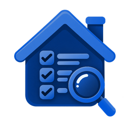
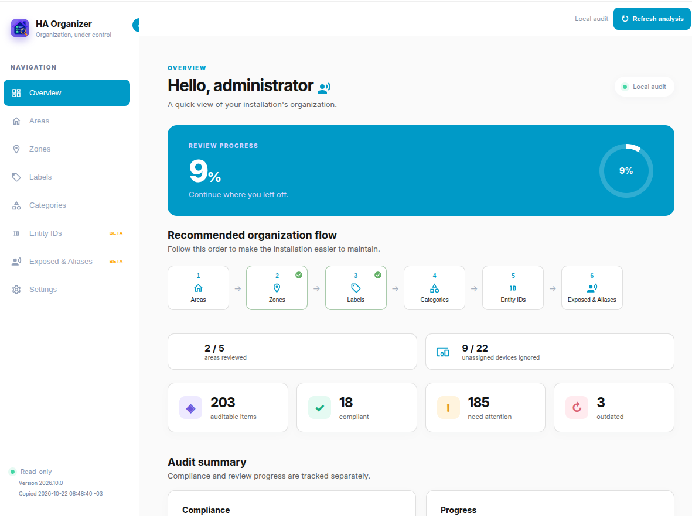
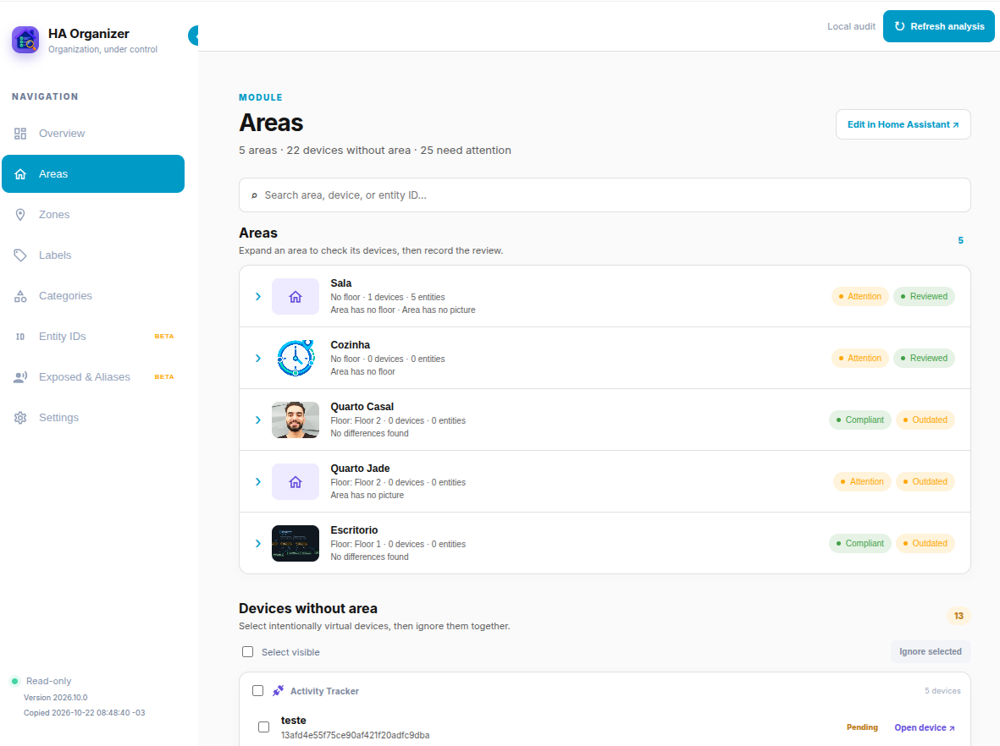
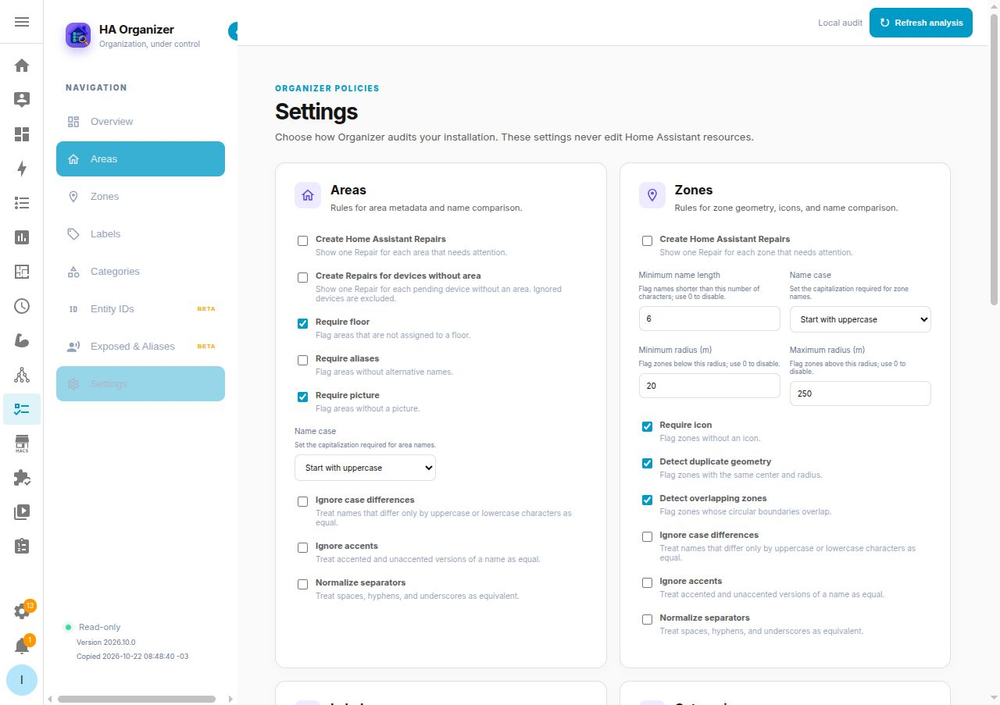

# HA Organizer

  

HA Organizer is a read-only Home Assistant custom integration for auditing the
organization of your installation. It provides a single place to inspect naming
consistency, duplicate or missing resources, review progress, and links to the
native Home Assistant screens where changes can be made manually.

## What it does

The integration adds an **HA Organizer** panel to Home Assistant with these
modules:

- **Overview** — consolidated compliance and review progress.
- **Categories** — compares automation and script categories, including names
  and icons.
- **Areas** — inventories areas, devices, and associated entities; records area
  reviews and supports searching and batch-ignoring devices without an area.
- **Zones** — reviews names, icons, radius, coordinates, and duplicate geometry.
- **Labels** — inventories label names, icons, and colors.
- **Entity IDs** — compares entity IDs with the naming policy configured in the
  Organizer.
- **Exposed & Aliases** — finds collisions among exposed names and aliases.

All modules are opt-in through the **Settings** page. The integration does not
rename, create, delete, or otherwise modify Home Assistant resources.

### Recommended organization flow

The Overview page presents the suggested maintenance order:

1. Areas
2. Zones
3. Labels
4. Categories
5. Entity IDs
6. Exposed & Aliases

This is a practical navigation order, not a requirement. Each module can be
opened independently whenever its native Home Assistant data is ready.

## Screenshots

The panel is designed for a focused, read-only review workflow:

### Overview

Overview combines compliance with human review progress, including completed
area reviews and intentionally ignored devices without an area.

### Areas

The Areas module expands each area to show its devices and entities. Devices
without an area can be filtered by name, device ID, or entity ID, selected in
bulk, and ignored together when they are intentionally virtual. Ignored devices
remain visible in a separate section and can be restored later.

### Settings

Settings are organized by audit module. They include optional Home Assistant
Repairs, area review policies, naming and normalization rules, and the beta
policies for Entity IDs and Exposed & Aliases.

## Review model

HA Organizer keeps technical compliance separate from human review:

- `compliant`, `non_compliant`, `attention`, and `not_applicable` describe the
  calculated audit result.
- `pending`, `reviewed`, `ignored`, and `stale` describe the user's progress.

Reviewed and ignored items are associated with a fingerprint of the relevant
data. If that data changes, the item becomes stale and can be reviewed again.
Only the Organizer's own settings, review decisions, and scan data are stored.

Area review is recorded separately from technical compliance: an administrator
can mark an area reviewed after checking its devices, while devices without an
area can be ignored individually or in a bounded batch. Those decisions are
included in Overview and become stale when the relevant inventory changes.

When enabled in Settings, the integration can also create Home Assistant
Repairs for non-compliant areas, zones, labels, and categories, plus pending
devices without an area. Ignored devices do not create Repairs.

## HACS availability

HA Organizer is available in HACS and is listed in the official default
catalog. Search for **HA Organizer** in **HACS > Integrations**, or use the
direct-open button above to open the repository in HACS.

## Installation

### HACS

1. Open **HACS > Integrations** and search for **HA Organizer**.
2. Install the integration and restart Home Assistant.
3. Open **Settings > Devices & services > Add integration**.
4. Search for **HA Organizer** and complete the minimal setup.

### Manual

Copy the `custom_components/ha_organizer` directory into the
`custom_components` directory of your Home Assistant configuration, restart
Home Assistant, and add the integration from **Settings > Devices & services**.

## Native Home Assistant links

Where possible, the panel links directly to the native Home Assistant pages:

- Areas: `/config/areas/dashboard`
- Zones: `/config/zone`
- Labels: `/config/labels`
- Exposed entities: `/config/voice-assistants/expose`

These links are intentionally simple navigation links. HA Organizer does not
edit native resources through its own WebSocket API.

The integration is also read-only with respect to native data when recording
review progress: review and ignore actions update only Organizer-owned state.

## Compatibility

HA Organizer `2026.10.2` requires Home Assistant `2026.8.0` or newer. See the
[compatibility matrix](docs/compatibility.md) for tested combinations and
release guidance.

## Development

Contributor commands, local Home Assistant testing, coverage requirements, and
SonarQube validation are documented in [Development and quality checks](docs/development.md).

## Privacy and safety

HA Organizer is local and read-only with respect to Home Assistant resources.
The panel may display entity names, areas, zones, and exposure information to
Home Assistant administrators, so access to the Home Assistant instance should
be protected in the usual way. Zone coordinates are shown with reduced visual
emphasis in the panel.

## Documentation

- [Compatibility matrix](docs/compatibility.md)
- [Development and quality checks](docs/development.md)
- [Product and architecture specification](docs/product-specification.md)
- [Changelog](CHANGELOG.md)
- [Icon concepts](docs/icons/README.md)

## License

HA Organizer is distributed under the [MIT License](LICENSE).
